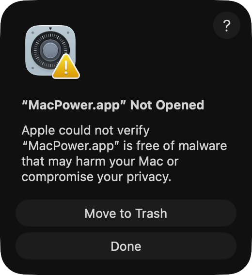
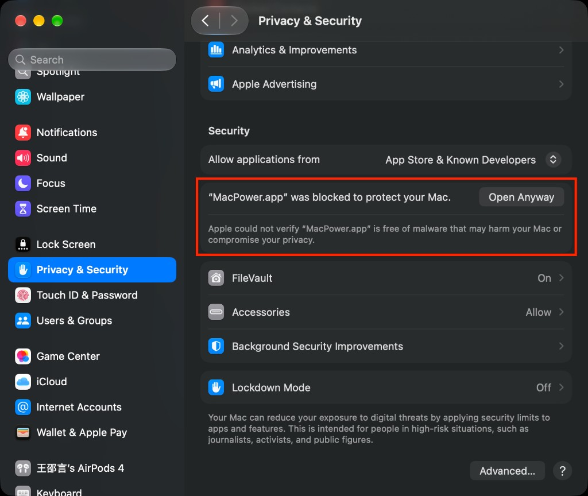

# MacPower

[](LICENSE) [![LINUX DO](https://img.shields.io/badge/LINUX-DO-FFB003.svg?logo=data:image/svg%2bxml;base64,DQo8c3ZnIHhtbG5zPSJodHRwOi8vd3d3LnczLm9yZy8yMDAwL3N2ZyIgd2lkdGg9IjEwMCIgaGVpZ2h0PSIxMDAiPjxwYXRoIGQ9Ik00Ni44Mi0uMDU1aDYuMjVxMjMuOTY5IDIuMDYyIDM4IDIxLjQyNmM1LjI1OCA3LjY3NiA4LjIxNSAxNi4xNTYgOC44NzUgMjUuNDV2Ni4yNXEtMi4wNjQgMjMuOTY4LTIxLjQzIDM4LTExLjUxMiA3Ljg4NS0yNS40NDUgOC44NzRoLTYuMjVxLTIzLjk3LTIuMDY0LTM4LjAwNC0yMS40M1EuOTcxIDY3LjA1Ni0uMDU0IDUzLjE4di02LjQ3M0MxLjM2MiAzMC43ODEgOC41MDMgMTguMTQ4IDIxLjM3IDguODE3IDI5LjA0NyAzLjU2MiAzNy41MjcuNjA0IDQ2LjgyMS0uMDU2IiBzdHlsZT0ic3Ryb2tlOm5vbmU7ZmlsbC1ydWxlOmV2ZW5vZGQ7ZmlsbDojZWNlY2VjO2ZpbGwtb3BhY2l0eToxIi8+PHBhdGggZD0iTTQ3LjI2NiAyLjk1N3EyMi41My0uNjUgMzcuNzc3IDE1LjczOGE0OS43IDQ5LjcgMCAwIDEgNi44NjcgMTAuMTU3cS00MS45NjQuMjIyLTgzLjkzIDAgOS43NS0xOC42MTYgMzAuMDI0LTI0LjM4N2E2MSA2MSAwIDAgMSA5LjI2Mi0xLjUwOCIgc3R5bGU9InN0cm9rZTpub25lO2ZpbGwtcnVsZTpldmVub2RkO2ZpbGw6IzE5MTkxOTtmaWxsLW9wYWNpdHk6MSIvPjxwYXRoIGQ9Ik03Ljk4IDcwLjkyNmMyNy45NzctLjAzNSA1NS45NTQgMCA4My45My4xMTNRODMuNDI2IDg3LjQ3MyA2Ni4xMyA5NC4wODZxLTE4LjgxIDYuNTQ0LTM2LjgzMi0xLjg5OC0xNC4yMDMtNy4wOS0yMS4zMTctMjEuMjYyIiBzdHlsZT0ic3Ryb2tlOm5vbmU7ZmlsbC1ydWxlOmV2ZW5vZGQ7ZmlsbDojZjlhZjAwO2ZpbGwtb3BhY2l0eToxIi8+PC9zdmc+)](https://linux.do) [](#requirements) [](https://swift.org) [](https://developer.apple.com/xcode/swiftui/) [](https://github.com/RyanStarFox/MacPower/releases)

<p align="center">
  
</p>

[中文](README.md) | English

A menu-bar battery monitor for MacBook. It stays out of the Dock and opens a **Liquid Glass** panel with live energy flow, status rings, and remaining runtime or time-to-full — highly customizable.

## Preview

<table>
  <tr>
    <td align="center" width="33%"><br><b>Battery → Mac</b> · particles</td>
    <td align="center" width="33%"><br><b>Adapter → Mac</b> · gradient</td>
    <td align="center" width="33%"><br><b>Adapter + battery → Mac</b> · filaments · high contrast</td>
  </tr>
  <tr>
    <td align="center"><br><b>Adapter → battery + Mac</b> · slide</td>
    <td align="center"><br><b>Battery → Mac</b> · smooth · filaments</td>
    <td align="center"><br><b>Adapter → battery + Mac</b> · no motion</td>
  </tr>
</table>

## Features

- Liquid Glass menu-bar monitor: energy flow, battery / CPU / GPU / memory rings, remaining runtime or time-to-full
- Highly customizable: color presets, icon packs, motion styles, menu-bar battery look, and more
- No Dock icon; optional open-at-login and automatic update checks
- Languages: Simplified Chinese, Traditional Chinese, English, Japanese, Korean, French, German, Spanish, Brazilian Portuguese, Italian, Russian (follow system or pick one in Settings)

## Install

### Homebrew

```bash
brew install --cask --no-quarantine ryanstarfox/tap/macpower
```

The disk image is ad-hoc signed and not notarized, so `--no-quarantine` is required. Official `homebrew/cask` does not accept a cask that has to bypass Gatekeeper; this command uses a personal tap.

### Disk image

1. Download the latest `MacPower-*.dmg` from [Releases](https://github.com/RyanStarFox/MacPower/releases), open it, and drag **MacPower** into **Applications**.
2. Double-click MacPower. macOS shows the window below. Click **Done**. Do not click **Move to Trash**. Both methods start after this window.

The disk image is not notarized by Apple. I do not have an Apple Developer account, which costs 99 USD a year, so macOS blocks the first launch. This is not a virus. MacPower is open source. The code is in the repository, and a virus in it would be visible there.



3. Then allow it with method 1. Use method 2 if method 1 does not work.
4. Open **System Settings → Menu Bar**, allow **MacPower** to appear in the menu bar, then launch it from Applications.

#### Method 1: Allow it in System Settings

Open **System Settings → Privacy & Security** and scroll the page to the bottom of the Security section. When you see **“MacPower.app” was blocked to protect your Mac**, click **Open Anyway** and confirm the prompt.



#### Method 2: Clear quarantine in Terminal

Open Terminal, paste the command below, and press Enter. Nothing appears while you type the password. Press Enter when you finish:

```bash
sudo xattr -rd com.apple.quarantine /Applications/MacPower.app
```

## Requirements

- macOS 14 or later (Liquid Glass on macOS 26+; material fallback on 14/15)
- Apple Silicon MacBook with a battery

## Build from source

```bash
brew install xcodegen
xcodegen generate
xcodebuild -project MacPower.xcodeproj -scheme MacPower -configuration Release -destination 'platform=macOS' build
```

Rebuild the Release disk image:

```bash
./scripts/make_dmg.sh
```

The `.dmg` lands in `dist/`.

## Mirror a release

After the GitHub Release is published, run this once on the Mac that is signed in to Aliyun Drive:

```bash
python3 scripts/sync_latest_release.py
```

One run does all three:

- Push GitHub `main` and that version tag to [Gitee](https://gitee.com/Ryan_LS_Wang/MacPower), create the release, and upload `MacPower-*.dmg`
- Upload the disk image to Aliyun Drive backup `/软件/MacPower`
- Upload the disk image to Baidu Netdisk `/apps/MacPower/releases/`

Gitee reads `machine gitee.com` from `~/.netrc` on this Mac. Do not put the token in the repository. If this version is already mirrored, the command exits.

Install notes live in the repository root: `如何安装.txt`, `如何安装.md`, `如何安装.html`, `如何安装.docx`, and the English files `how2install.txt`, `how2install.md`, `how2install.html`, `how2install.docx`. They do not change per version and are not uploaded again with each release.

The Baidu refresh token is authorized once. The script saves the replacement token locally after each refresh. The first time, or after the token is rejected, run:

```bash
python3 scripts/set_baidu_refresh_token.py
```

The terminal prints a verification URL and a user code. Open that URL, sign in to Baidu, enter the code, and confirm. The token is then stored on this Mac.

## License

This project is licensed under the MIT License with the Commons Clause. You may use, modify, and distribute it free of charge, but you may not sell the software or monetize a product or service whose value derives substantially from its functionality. See [LICENSE](LICENSE).

---

This open-source project is linked with and acknowledges the [LINUX DO community](https://linux.do).
