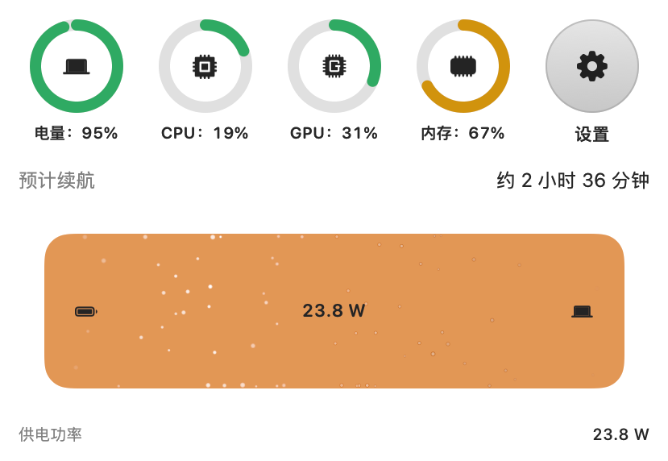
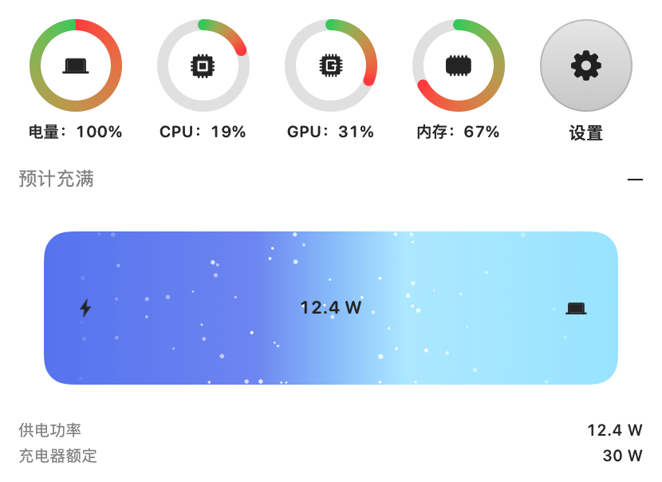
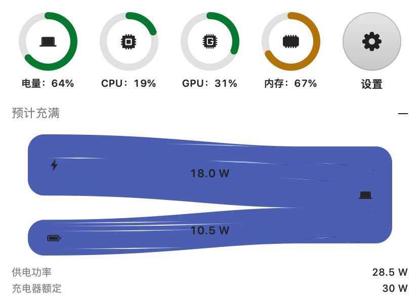
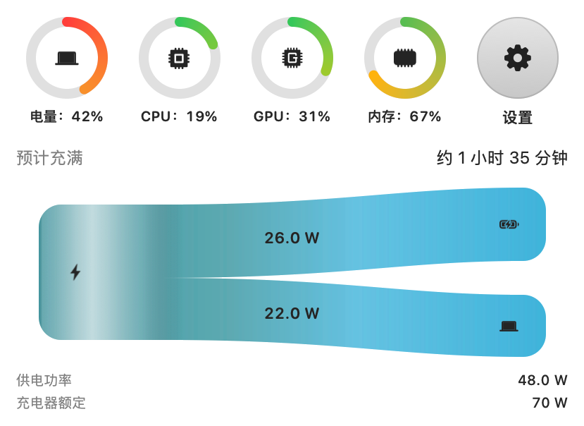
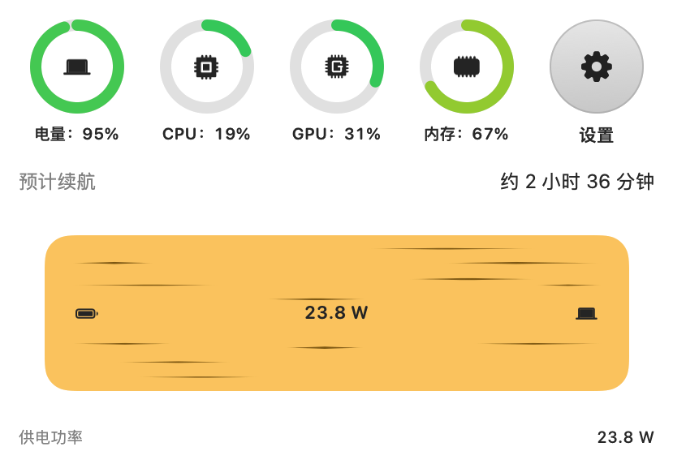
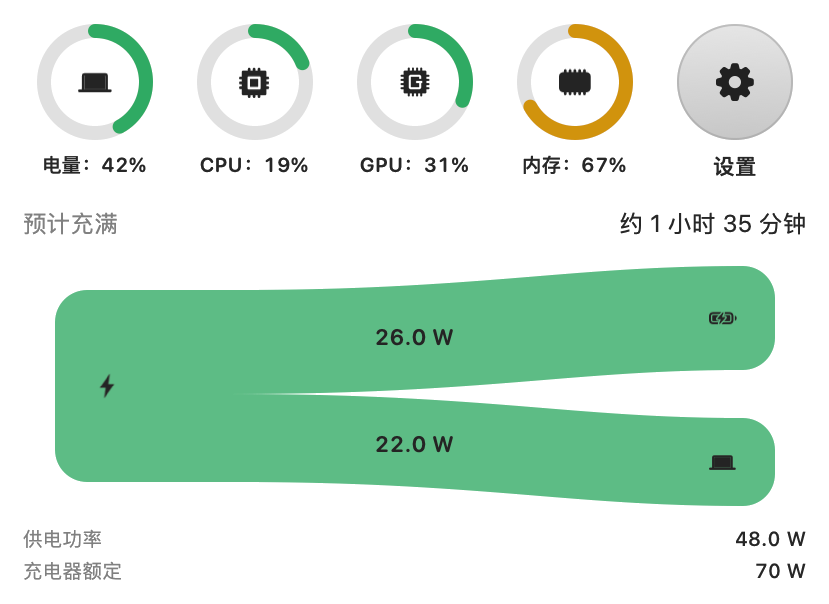
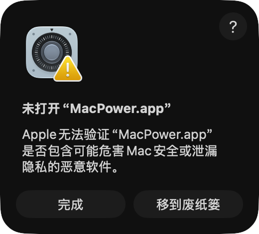
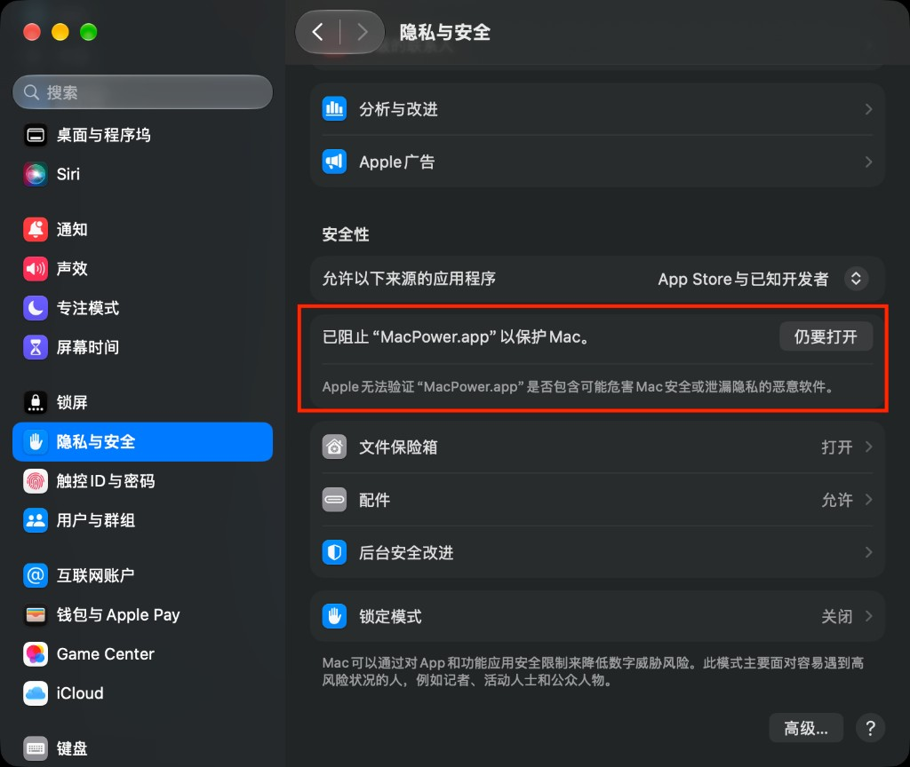

# MacPower

 ![LINUX DO](https://img.shields.io/badge/LINUX-DO-FFB003.svg?logo=)    


中文 | [English](README.en.md)

MacBook 菜单栏电池监视器。不进 Dock，点开后是 **Liquid Glass** 监控面板：能量流向、系统圆环、续航或充满时间，外观与动效都可自定义。

## 预览


|                                                                       |                                                                                   |                                                                                       |
| --------------------------------------------------------------------- | --------------------------------------------------------------------------------- | ------------------------------------------------------------------------------------- |
|  **电池 → 电脑** · 粒子      |  **电源 → 电脑** · 渐变                 |  **电源 + 电池 → 电脑** · 细线 · 高对比 |
|  **电源 → 电池 + 电脑** · 滑动 |  **电池 → 电脑** · 柔和 · 细线 |  **电源 → 电池 + 电脑** · 无动效           |


## 功能

- 菜单栏 Liquid Glass 监控面板（能量流向、电量 / CPU / GPU / 内存圆环、续航或充满时间）
- 高度可自定义：配色预设、图标套装、动效样式、菜单栏电池外观等
- 不进 Dock；可选登录时启动、自动检查更新
- 多语言：简体中文、繁体中文、English、日本語、한국어、Français、Deutsch、Español、Português (Brasil)、Italiano、Русский（设置里可跟随系统或单独切换）


## 安装


### 第一步：下载并安装

从 [Releases](https://github.com/RyanStarFox/MacPower/releases) 下载最新的 `MacPower-*.dmg`，打开后把 **MacPower** 拖进 **应用程序**。

也可以用 Homebrew：

```bash
brew install --cask --no-quarantine ryanstarfox/tap/macpower
```

`--no-quarantine` 是必须的。官方 `homebrew/cask` 不接收这类安装包，这里用的是个人 tap。用这条命令安装时，第二步的拦截通常不会出现，第三步仍然要做。

### 第二步：处理被系统拦住

安装包没有经过 Apple 公证。我没有购买 Apple 开发者账号，个人账号每年 99 美元，所以系统会拦住第一次打开。这不是病毒。MacPower 是开源软件，代码都在仓库里，如果里面有病毒，看源码就能看出来。

双击打开 MacPower。系统会弹出下面这个窗口。点 **完成**，不要点 **移到废纸篓**。方法一和方法二都会先看到它。



接着用方法一允许打开。方法一不行，再用方法二。

#### 方法一：在系统设置里允许打开

打开 **系统设置 → 隐私与安全**，把右边页面拉到「安全性」最下面。看到 **已阻止「MacPower.app」以保护 Mac** 后，点右边的 **仍要打开**，再按提示确认。



#### 方法二：用终端清除隔离

打开「终端」，粘贴下面的命令并回车。输入密码时屏幕不会显示圆点，输完直接回车：

```bash
sudo xattr -rd com.apple.quarantine /Applications/MacPower.app
```

### 第三步：在菜单栏里显示

打开 **系统设置 → 菜单栏**。

- 允许 **MacPower** 在菜单栏中显示，然后从「应用程序」启动。
- 建议关掉系统自带的 **电池**。菜单栏只留 MacPower，避免两个电池图标叠在一起。这一项可以不关。

## 运行要求

- macOS 14 或更高（在 macOS 26+ 上使用 Liquid Glass；14/15 为材质回退）
- 带电池的 Apple 芯片 MacBook


## 从源码编译

```bash
brew install xcodegen
xcodegen generate
xcodebuild -project MacPower.xcodeproj -scheme MacPower -configuration Release -destination 'platform=macOS' build
```

重新制作 Release 磁盘镜像：

```bash
./scripts/make_dmg.sh
```

生成的 `.dmg` 在 `dist/`。

## 发布后同步

GitHub Release 发出去之后，在这台已经登录阿里云盘的 Mac 上再执行一次：

```bash
python3 scripts/sync_latest_release.py
```

同一次会做这三件事：

- 把 GitHub 上的 `main` 和该版本 tag 推到 [Gitee](https://gitee.com/Ryan_LS_Wang/MacPower)，创建对应发行版，并上传 `MacPower-*.dmg`
- 把安装包上传到阿里云盘备份盘 `/软件/MacPower`
- 把安装包上传到百度网盘 `/apps/MacPower/releases/`

Gitee 使用本机 `~/.netrc` 里的 `machine gitee.com`，私人令牌不要写进仓库。这个版本已经同步过时，命令会直接结束。

安装说明是仓库根目录里的固定文件：`如何安装.txt`、`如何安装.md`、`如何安装.html`、`如何安装.docx`，以及英文的 `how2install.txt`、`how2install.md`、`how2install.html`、`how2install.docx`。内容不随版本变化，不随每次 Release 重复上传。

百度的 refresh token 只授权一次。脚本刷新后会把新 token 存回本机，不用每次手动改。第一次，或 token 失效后：

```bash
python3 scripts/set_baidu_refresh_token.py
```

终端会打印授权网址和用户码。在浏览器打开那个网址，登录百度，输入用户码并确认。完成后 token 会写入本机。

## 许可证

本项目采用 MIT License，并附加 Commons Clause。允许免费使用、修改和分发，但不得销售本软件，或通过主要依赖本软件功能的产品或服务获利。详见 [LICENSE](LICENSE)。

---

本开源项目已链接并认可 [LINUX DO 社区](https://linux.do)。